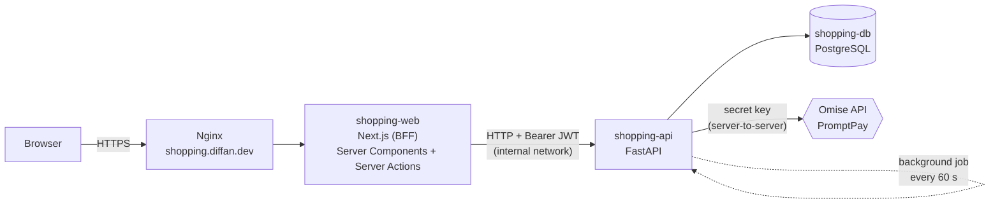
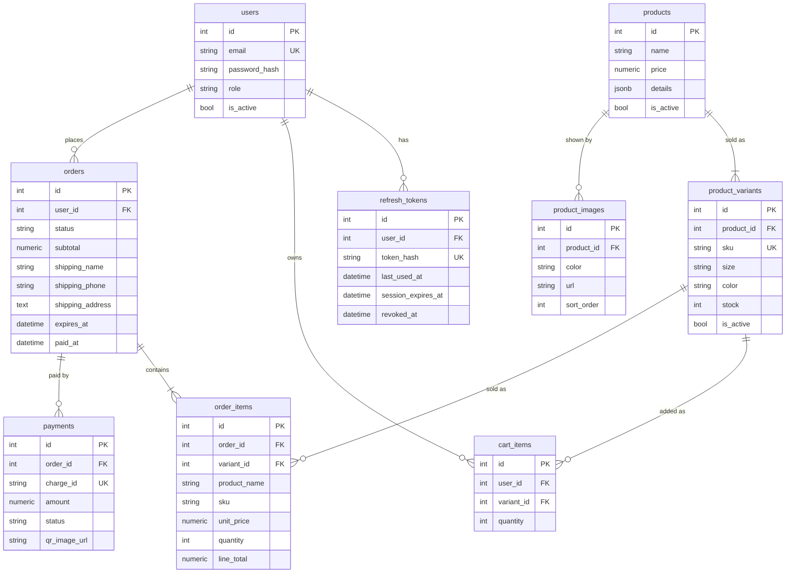

# Shopping App

A lifestyle e-commerce store (clothing, shoes, plush toys, cosmetics) that replaces the earlier PHP demos (`archive/lovelypet`, `archive/ministock`).
Code: [`apps/shoppingapp-next`](../../apps/shoppingapp-next) · Live: `https://shopping.diffan.dev`

**Stack:** Next.js 16 (App Router, TypeScript, Tailwind) · FastAPI · SQLAlchemy 2 + Alembic · PostgreSQL 17 · Omise (test mode) · Docker · Nginx · GitHub Actions

---

## Architecture



- **BFF (Backend for Frontend):** the browser only talks to Next.js. Tokens live in `httpOnly` cookies held by the Next.js server; the API and the database are not reachable from the internet.
- **API is the single source of truth** for every rule: role checks, stock, prices, payment verification. The UI never decides anything security-relevant.
- **Defense in depth:** authorization is enforced twice (Next.js page guard + API dependency), and data integrity is enforced twice (Pydantic validation + database constraints).

---

## Feature index

| ID | Feature | Entry point | API | Tables | Tests |
|---|---|---|---|---|---|
| [L-00](flows/L-00-health.md) | Health check | `/status` | `GET /health` | — | `test_health.py` |
| [L-01](flows/L-01-storefront.md) | Storefront: browse, search, sort, pick colour/size | `/`, `/products/[id]` | `GET /products`, `GET /products/{id}` | products, product_variants, product_images | `test_storefront.py` |
| [L-02](flows/L-02-cart.md) | Cart | `/cart` | `GET /cart`, `POST/PATCH/DELETE /cart/items` | cart_items | `test_cart.py` |
| [L-03](flows/L-03-checkout.md) | Checkout (stock reservation, price snapshot) | `/checkout` | `POST /orders`, `GET /orders` | orders, order_items | `test_checkout.py` |
| [L-04](flows/L-04-payment.md) | Payment via Omise PromptPay (test mode) | `/orders/[id]` | `POST /orders/{id}/payment`, `POST .../check` | payments | `test_payments.py` |
| [L-07](flows/L-07-order-expiry.md) | Auto-expire unpaid orders, release stock | background job | — | orders, product_variants, payments | `test_expiry.py` |
| [L-08](flows/L-08-auth-rbac.md) | Sign-up / login, JWT + refresh rotation, RBAC | `/login`, `/register` | `/auth/*`, `GET /admin/users` | users, refresh_tokens | `test_auth.py`, `test_auth_policy.py`, `test_privacy.py` |
| [L-09](flows/L-09-backoffice-products.md) | Back office: products, variants, images | `/backoffice/products` | `/admin/products`, `/admin/variants`, `/admin/images` | products, product_variants, product_images | `test_products.py` |

Customer journey (swimlane, non-technical): [customer-journey.md](customer-journey.md) · Progress and what comes next: [ROADMAP.md](ROADMAP.md)

**Backlog:** L-06 card payments (Omise.js + 3-D Secure) · L-10 restock with stock-movement ledger · L-11 categories · L-12 admin dashboard · L-14 MFA (TOTP) · L-15 audit log · L-16 rate limiting · L-17 admin show/hide for personal data · payment webhooks · back-office order list

---

## Business rules

| Area | Rule |
|---|---|
| Roles | `customer` buys · `staff` manages products, stock and orders · `admin` is a superuser (can do everything staff can, plus members and dashboard) so issues can be triaged before escalating to developers |
| Sessions | staff/admin: 30-minute idle timeout (sliding) + 8-hour absolute limit · customer: 7-day absolute limit · access token 15 minutes |
| Catalogue | Stock is tracked **per variant** (e.g. white tee, size M) · products and variants are never hard-deleted, only suspended (`is_active=false`) because orders reference them · images are referenced by HTTPS URL and grouped **by colour** (colour changes appearance, size does not) |
| Storefront | Exact stock numbers are never exposed: `in_stock` / `low_stock` (≤ 3) / `sold_out` |
| Cart | Login required · the cart **never reserves stock** (prevents inventory hoarding / denial-of-inventory) · max 10 per line · prices are always current |
| Checkout | Stock is deducted at checkout, all-or-nothing · prices and product details are snapshotted into the order · the order reserves stock for **1 hour** |
| Payment | PromptPay QR via Omise · the server verifies status, amount, currency and order id with Omise directly; the browser's word is never trusted |
| Expiry | Unpaid orders past the window are expired and stock is released · Omise is checked first, so a last-minute payment is honoured · if Omise is unreachable the order is left alone until the next run |
| Privacy | Personal data shown to anyone other than its owner is masked on the server (`admin@example.com` → `a***n@e*****e.com`) |

---

## Data model



Order status lifecycle: `pending_payment` → `paid` · `pending_payment` → `expired` (`awaiting_verification` and `cancelled` are reserved for future flows).

Database constraints back the business rules: `CHECK (stock >= 0)`, `CHECK (price >= 0)`, `UNIQUE (sku)`, `UNIQUE (user_id, variant_id)` on cart items, `CHECK (status IN (...))`.

---

## Security model

| Concern | Control |
|---|---|
| Password storage | Argon2 (pwdlib) · constant-time path for unknown e-mails, identical error message (no user enumeration) |
| Tokens | Short-lived JWT (15 min) + rotating refresh token stored hashed (SHA-256) and revocable · `httpOnly`, `SameSite=Lax`, `Secure` cookies |
| Authorization | RBAC enforced at the API (`require_roles`) and again at the Next.js page level · other users' orders/carts return 404, not 403 |
| IDOR | `user_id` always comes from the verified JWT, never from the request |
| Overselling | `SELECT ... FOR UPDATE` on variants, locked in id order to avoid deadlocks · verified by a two-thread race test |
| Payments | Server-to-server verification (status, amount in satang, currency, order id) · one active QR per order |
| Input | Pydantic with `extra="forbid"` · HTTPS-only image URLs · open-redirect guard on `?next=` |
| Secrets | `.env` only (never committed); compose refuses to start without required secrets |

---

## Testing

- **94 automated tests** (pytest, FastAPI `TestClient`) against a real PostgreSQL test database; each test runs inside a transaction that is rolled back.
- External services are replaced by **test doubles** (`tests/fakes.py: FakeOmise`) to simulate success, underpayment, wrong order, expiry and outages.
- A **concurrency test** starts two buyers at the same instant (`threading.Barrier`) for the last item; exactly one succeeds and stock never goes negative.
- Business rules have their own spec-style tests (`test_auth_policy.py`, `test_privacy.py`).
- CI runs the API tests, TypeScript type checks and ESLint before any image is built.

---

## Running locally

```bash
cd apps/shoppingapp-next
cp api/.env.example api/.env                 # optional, only for running the API outside Docker
echo "OMISE_SECRET_KEY=skey_test_..." > .env  # optional, enables payments
docker compose up -d                          # db (5433) + api (8100, hot reload)
cd web && npm install && npm run dev -- --port 3100
```

Seed data and the first staff/admin account:

```bash
docker compose exec api python -m app.scripts.seed_products            # 15 products, 89 variants, colour images
docker compose exec api python -m app.scripts.create_user admin@example.com admin
```

Tests: `cd api && uv run pytest -q` (needs the db container running).

---

## Deployment runbook (EC2)

**1. Secrets** — stored once in GitHub (**Settings → Secrets and variables → Actions → New repository secret**). The deploy job passes them over SSH and writes `~/aws-devops-resume-stack/.env` on the server (mode 600, git-ignored) on every deploy.

| Secret | Value |
|---|---|
| `SHOPPING_DB_PASSWORD` | `openssl rand -hex 24` (hex only: the password is embedded in a database URL, so `@ : / ?` would break it) |
| `SHOPPING_JWT_SECRET` | `openssl rand -hex 32` |
| `OMISE_SECRET_KEY` | `skey_test_...` (optional; payments are disabled without it) |

The job stops before touching the server if either of the first two is missing, and `docker compose` also refuses to start without them.
PostgreSQL applies `SHOPPING_DB_PASSWORD` only when its data volume is first created; changing the secret later also requires `ALTER USER shop PASSWORD '...'` inside the database.

**2. TLS certificate** — the existing certificate (`--cert-name diffan.dev`) still lists `lovelypet.diffan.dev`, whose DNS record was removed. Renewal validates every name, so it would fail for the whole certificate. Re-issue it with the new name list after the new Nginx config is live:

```bash
sudo certbot certonly --webroot -w /var/www/certbot --cert-name diffan.dev \
  -d diffan.dev -d www.diffan.dev -d grafana.diffan.dev -d shopping.diffan.dev
docker exec nginx-proxy nginx -t && docker exec nginx-proxy nginx -s reload
sudo certbot renew --dry-run   # confirm automatic renewal works with the new list
```

**3. Deploy** — push to `main`. CI runs tests, builds `shopping-api` / `shopping-web` (tagged with the commit SHA and `latest`), generates SBOMs, then on the server: pulls images, starts `shopping-db`, recreates the app containers (the API runs `alembic upgrade head` on start), removes orphaned containers (`lovelypet-app`, `ministock`, `mysql-db`), validates and reloads Nginx.

**4. First-run data** (once):

```bash
docker compose exec shopping-api python -m app.scripts.create_user <admin e-mail> admin
docker compose exec shopping-api python -m app.scripts.seed_products
```

**Shortcut without SSH:** steps 2 and 4, plus a load/RAM report, run from **Actions → Ops (manual tasks on EC2) → Run workflow** (`renew-tls-cert`, `seed-products`, `create-admin`, `status-report`). `create-admin` reads the e-mail and password from the secrets `SHOPPING_ADMIN_EMAIL` and `SHOPPING_ADMIN_PASSWORD`.

**Rollback:** `SHOPPING_TAG=<commit sha> docker compose up -d shopping-api shopping-web`

**Clean-up (optional, irreversible):** the old MySQL volume is kept; remove it once you are sure: `docker volume ls | grep mysql_data` → `docker volume rm <name>`.

### Known limitations

- Payment confirmation is pull-based (customer presses "check status"; the expiry job also checks). Webhooks need a public endpoint and are on the backlog.
- If a customer pays a PromptPay QR **after** the order has expired, the money arrives but the order stays expired; a manual refund is needed.
- The idle timeout is measured at refresh time, so its precision is ±15 minutes (the access-token lifetime).
- No rate limiting yet on `/auth/login` (L-16).
