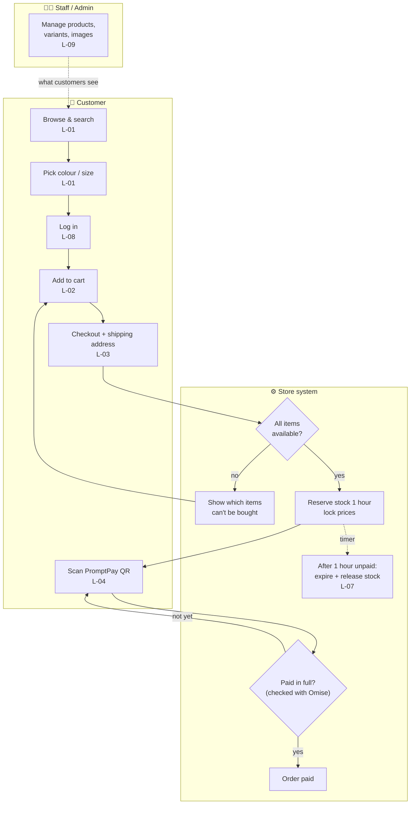

# Customer journey (swimlane)

Business-level view for non-technical readers. Each step carries the flow ID so the team can jump to the technical diagram.

Legend: lanes show who acts · ◇ decisions · dashed lines happen without anyone clicking.
