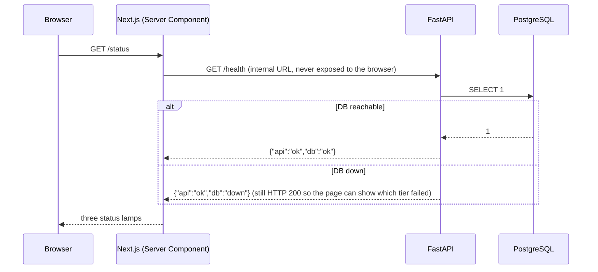

# L-00 Health check

Proves every tier is wired: browser → Next.js server → FastAPI → PostgreSQL.

- `connection()` makes the page render per request (not at build time).
- Session-per-request: `get_session()` yields one SQLAlchemy session per request and always closes it.
- Tests: all-ok against the real DB; DB-down via a dependency override that raises `OperationalError`.
