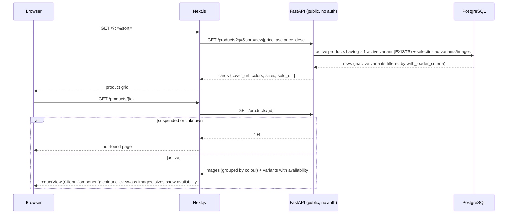

# L-01 Storefront

Public catalogue: grid with search and sort, product page with colour/size picker.

| Rule | Implementation |
|---|---|
| Never expose exact stock | `availability(stock)` → `in_stock` / `low_stock` (≤ `LOW_STOCK_THRESHOLD`, default 3) / `sold_out`; no `stock` field in the public schema |
| Suspended items disappear | filtered in SQL, not in the UI |
| Images follow colour | `product_images.color`; `NULL` = general/cover image |
| Search & sort are shareable | plain GET form, state lives in the URL |

Separate public endpoint (`/products`) instead of reusing `/admin/products`: hiding fields in the UI would still ship the data to the browser.
