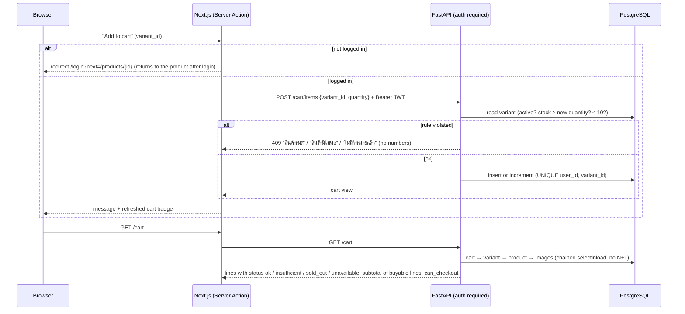

# L-02 Cart

| Rule | Why |
|---|---|
| The cart never reserves stock | prevents inventory hoarding (denial of inventory); stock is taken at checkout |
| Login required | quantities are tied to an identified user |
| `user_id` from the JWT only | prevents IDOR (editing another user's cart) |
| Prices are always current | the price is locked when the order is created (L-03) |
| Lines re-evaluated on every read | items can sell out or be suspended after being added |
| `?next=` must be an internal path | open-redirect guard (`//evil.com` → `/`) |
