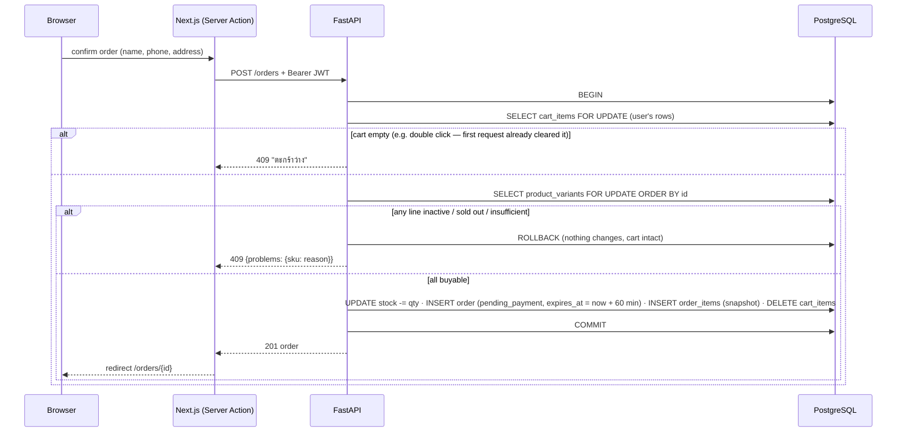

# L-03 Checkout

The core transaction: deduct stock and create the order atomically.

| Concern | Approach |
|---|---|
| Overselling | row locks on variants; a two-thread race test proves only one buyer gets the last item |
| Deadlocks | every transaction locks variants in ascending id order |
| Partial orders | all-or-nothing; the customer fixes the cart and retries |
| Price changes later | `order_items` stores name, SKU, colour, size and unit price at purchase time |
| Duplicate submissions | cart rows are locked and deleted in the same transaction; the second request finds an empty cart |
| Visibility | owner only; other users get 404 (does not confirm the id exists) |
| Shipping data | owner sees it in full; staff views must mask it (team masking standard) |

Settings: `ORDER_PAYMENT_WINDOW_MINUTES` (default 60).
