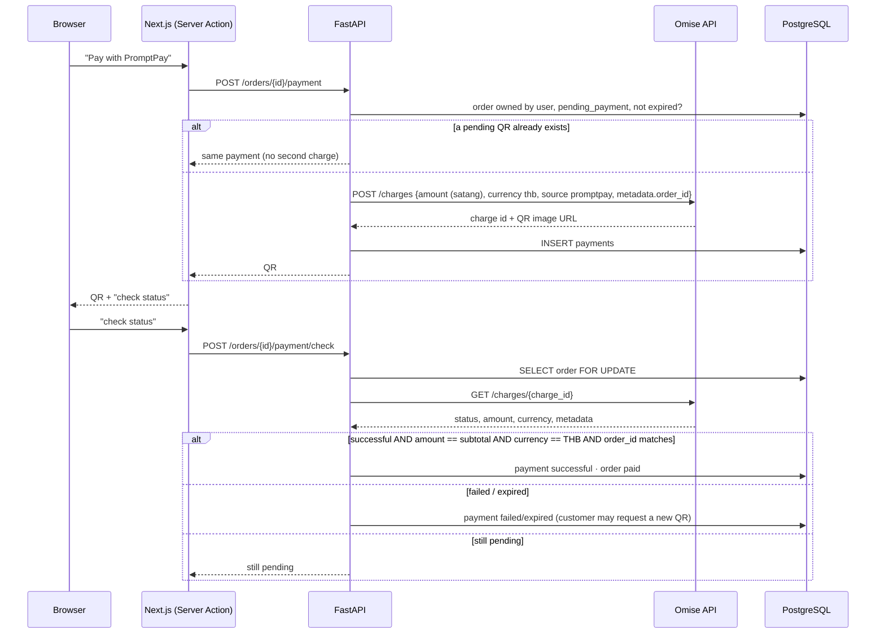

# L-04 Payment (Omise PromptPay, test mode)

- **Never trust the client:** the browser only asks the server to check; the server asks Omise with the secret key.
- Amount, currency and order id are compared to block underpayment and replaying another order's charge.
- `OmiseClient` is a small `httpx` wrapper injected with `Depends(get_omise)`; tests swap in `FakeOmise`.
- Pull-based confirmation for now (localhost cannot receive webhooks); add a webhook endpoint once deployed.
- Test mode: simulate a customer payment with `POST /charges/{id}/mark_as_paid` (test keys only).
