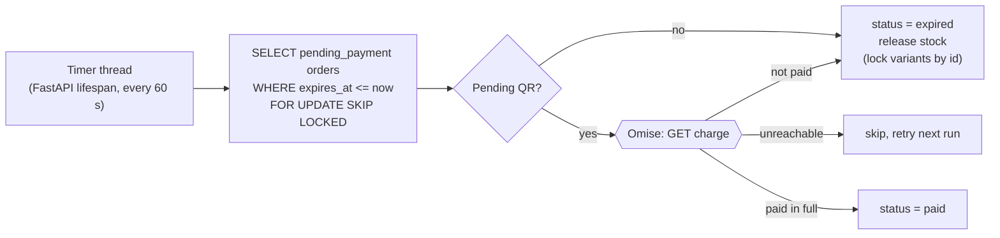

# L-07 Order expiry (background job)

| Decision | Reason |
|---|---|
| Check Omise before expiring | a customer who paid in the last minute must not lose the order |
| Unreachable provider → skip | when unsure, do not cancel |
| `SKIP LOCKED` | safe with several API replicas; never blocks on a row a customer is checking |
| Thread in the API process | no extra container on a 1 GB instance |
| Shared `apply_charge()` | one implementation of the "paid correctly" rule for both the check button and the job |

Settings: `EXPIRE_JOB_ENABLED` (disabled in tests), `EXPIRE_JOB_INTERVAL_SECONDS`.
Manual run: `docker compose exec shopping-api python -m app.scripts.expire_orders`.
Known gap: a QR paid after expiry needs a manual refund.
