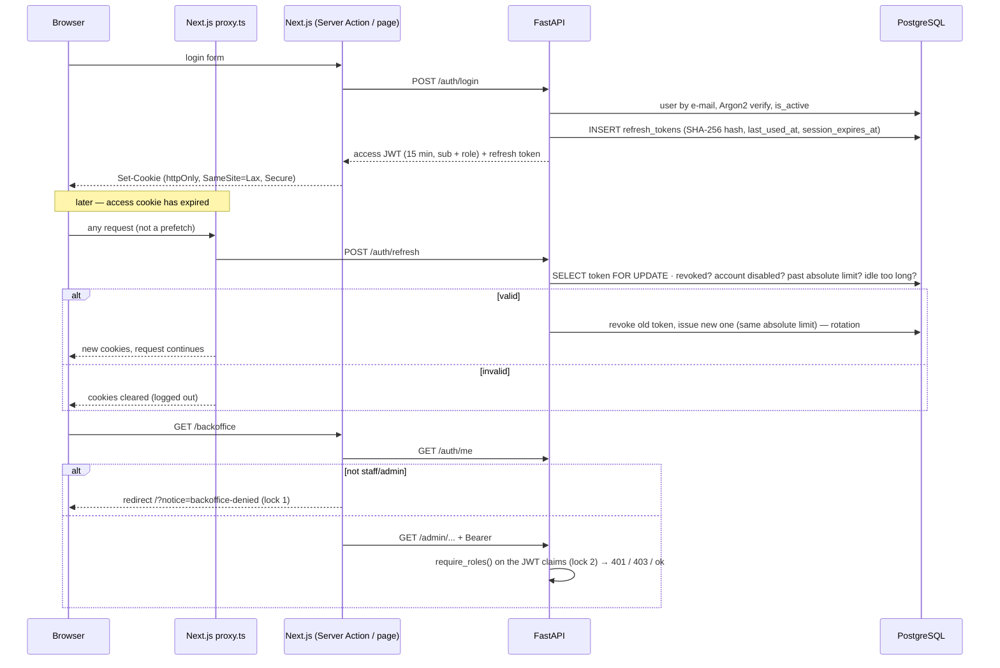

# L-08 Authentication + RBAC

| Role | Can |
|---|---|
| customer | shop, own cart and orders |
| staff | back office: products, stock, orders |
| admin | everything (superuser) + members, dashboard |

| Policy | customer | staff / admin |
|---|---|---|
| Idle timeout (sliding) | none | 30 min |
| Absolute session limit | 7 days | 8 hours |

- Role checks read the JWT only (no DB hit); a disabled account loses access within one access-token lifetime.
- `/admin/users` returns other members' e-mails masked; the requesting admin sees their own in full.
- The hidden back-office button is UX only; the real locks are the page guard and the API dependency.
