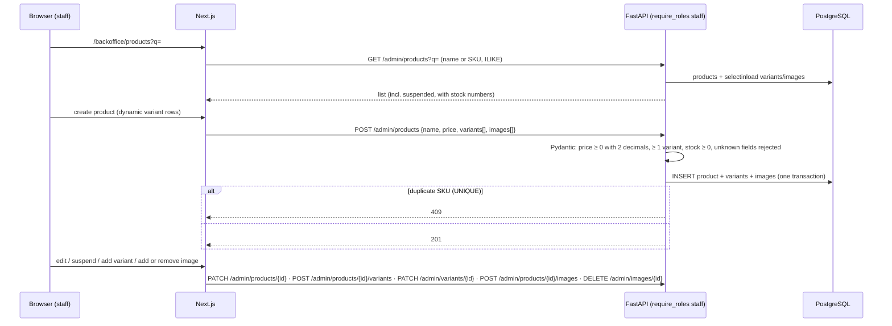

# L-09 Back office: products, variants, images

| Rule | Implementation |
|---|---|
| No hard delete of products or variants | no DELETE route (405); suspend with `is_active=false` |
| Stock set only on creation | `VariantUpdate` has no `stock` field (`extra="forbid"` → 422); later changes go through restock (L-10, backlog) so every change is recorded |
| Money | `Numeric(10,2)` / `Decimal`, serialised as strings (`"390.00"`) |
| SKU | trimmed and upper-cased; uniqueness enforced by the database |
| Images | HTTPS URLs only, grouped by colour; images can be deleted (not transactional data) |

Seed: `python -m app.scripts.seed_products` creates 15 products / 89 variants with colour-matched placeholder images; idempotent.
